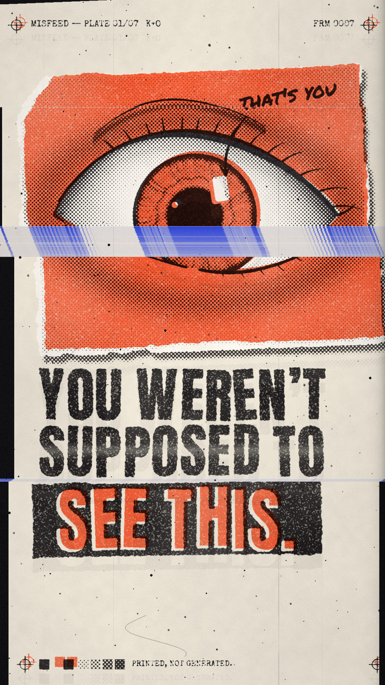

# MISFEED

**A signature animation style for Shorts. It looks like a photocopier ate the video.**



Every frame is printed rather than generated. Two inks go down on newsprint, and
then a badly behaved copier messes them up. The plates misregister. The page
slides on the glass halfway through a scan, so the scanner's black glass shows
through the gap and the stuck row drags down into blue streaks. The drum leaves
a ghost and a scratch, and dust sits on the glass. Nothing comes from an image
model, so there's no AI sheen and no garbled lettering, and the same hand-drawn
eye won't melt between frames.

| File | What |
|---|---|
| `out/misfeed_key.png` | the hero still, 1080×1920 |
| `out/misfeed_hook.mp4` | a 7 s seamless loop with sound, 24 fps, 9:16 |
| `out/misfeed_beats.png` | storyboard of the seven beats |
| `misfeed.py` | the press: renders all of the above, and treats your own photos and clips |

---

## The seven rules

1. **Two inks, one paper.** Toner black `#161418` and misfeed orange `#FF4A1C`
   on newsprint `#ECE5D6`. Nothing else prints.
2. **Blue only exists inside a fault.** Scan blue `#2640FF` appears only in a
   drag band. Never use it for a title, a graphic or a background. Because it's
   rare, the glitch beat lands as an event rather than decoration.
3. **The plates never line up.** The orange plate sits about 10 px right and
   7 px up. Registration targets print on both plates in the corners, so the
   offset shows.
4. **Draw on twos, break on ones.** Linework, type and paper texture redraw
   every 2 frames (a 12 fps boil from cycling three "copies" of the page).
   Faults hit on single frames, so they feel faster than everything else.
5. **One misfeed per turn.** The slip is the hook mechanic. Every row below it
   shifts sideways, the black glass shows in the gap, and the stuck row smears
   down in blue. Put it on the reveal word or the turn of the story, not at
   random.
6. **Type is stamped, not typed.** Set it in Anton as a justified stack, every
   line fitted to the same width. Each letter gets its own tilt and baseline.
   The last line is reversed out of a torn toner bar with orange in the
   counters. Each word lands on its own frame with a thud.
7. **The machine's scars don't move.** The drum scratches, the toner-starved
   band and the glass dust stay in the same place on every frame. That
   consistency makes it read as a real object instead of a filter.

## The signature marks

- **The phone in the eye.** The catchlight is a 9:16 phone screen, which
  means the reflection is the viewer. A marker scribble ("that's you") points
  at it. Reuse it on any glossy surface: eyes, sunglasses, a spoon, a
  puddle.
- **The slug line.** `MISFEED — PLATE 01/07 · K+O` with a running `FRM`
  counter. The plate number doubles as series numbering ("part 1 of 7").
- **The control strip.** Ink swatches and halftone tint steps, plus the brand
  line `PRINTED, NOT GENERATED.`

## Hook timing (the 7 s loop)

| t | Beat | Sound |
|---|---|---|
| 0.00 | The lamp sweeps. Frame 0 shows the eye on the new copy and the **whole hook** still on the old copy underneath | scanner whoosh |
| 0.17–1.17 | The hook stamps in word by word, with a shake and a plate jump on every word | one thud per word, the last one heavier |
| 1.25 | The eye snaps from off-camera to the viewer | tick |
| 1.67–2.50 | "that's you" writes on and the arrow lands on the phone catchlight | marker squeak |
| **2.75** | **MISFEED**: 5 frames of slipping page, blue drag and jumping plates, and the pupil blows wide. It settles into the key frame | bit-crushed jam crunch + sub drop |
| 4.00 | Slow blink, on twos | soft clicks |
| 6.25 | The page twitches, then the lamp sweeps back into frame 0 | small stutters, whoosh |

The text sits between y 1030 and y 1560, clear of the Shorts title and caption
area at the bottom and of the button column on the right.

## Use it

Python 3 with `numpy` and `Pillow`, and `ffmpeg` for video. Fonts (Anton,
Permanent Marker, Special Elite) download into `fonts/` on the first run.

```sh
python3 style/misfeed/misfeed.py all        # key + beats + loop -> out/
python3 style/misfeed/misfeed.py key --hook "NOBODY|NOTICED|THIS." --note "look again"
python3 style/misfeed/misfeed.py anim --hook "THE LABEL|IS|LYING."

# print your own footage in MISFEED (riso duotone, on twos, misfeeds where you say)
python3 style/misfeed/misfeed.py treat photo.jpg
python3 style/misfeed/misfeed.py treat clip.mp4 --glitch 0.4,3.1,7.8
```

`--hook` splits lines on `|`, and the last line goes on the toner bar. Short
lines work best: 2–4 words per line, 3 lines total.

## Doing it by hand in an editor

If you're cutting in CapCut, Premiere or After Effects without the script,
these steps get you most of the way:

1. Duotone the footage: shadows to black, midtones to orange `#FF4A1C`, highlights to paper.
2. Halftone the black layer at 45° and the orange layer at 15°.
3. Nudge the orange layer +10 px x and −7 px y. Leave it there for good.
4. Step the footage to 12 fps (hold every frame for two), but cut faults on
   single frames.
5. For the misfeed: duplicate the frame, mask everything below one row and
   slide it 30–80 px sideways. Fill the gap with near-black. Stretch the row at
   the cut down 80–200 px, tint it blue `#2640FF`, and hold it for 1–5 frames.
6. Multiply a paper texture over everything, then add fine grain and a couple
   of fixed vertical scratch lines.
